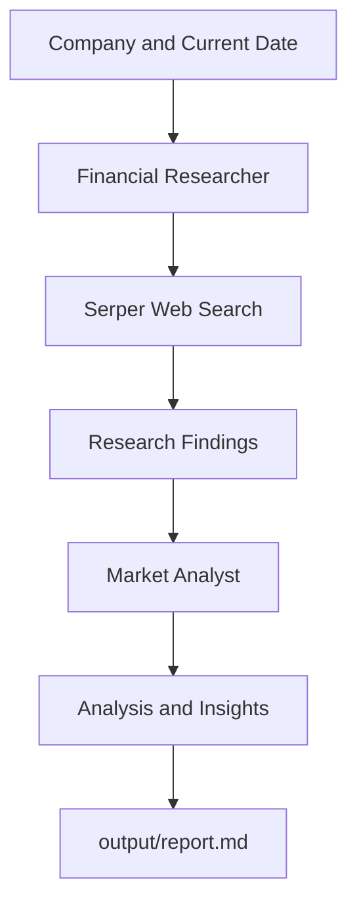

# Financial Researcher — Multi-Agent AI Company Analysis

A multi-agent financial research application built with **CrewAI**. It researches a company using web search, analyzes the findings, and generates a structured report covering company performance, recent developments, challenges, opportunities, and future outlook.

The current implementation researches **NVIDIA** by default.

## How It Works

The crew uses two specialized agents that execute sequentially:

1. **Financial Researcher:** Uses web search to gather up-to-date information about the company, including its current position, historical performance, challenges, opportunities, recent news, and future outlook.
2. **Market Analyst:** Analyzes the research findings, identifies trends, and produces a professional report with an executive summary, analysis, and market outlook.

The analyst receives the research task's output as context, allowing it to build on the research instead of starting from scratch.



## Tech Stack

- **Python:** `>=3.10,<3.14`
- **CrewAI:** `1.14.4`
- **uv:** Dependency and environment management
- **MixRoute:** LLM API access
- **SerperDevTool:** Web search for company research
- **YAML:** Agent and task configuration
- **Markdown:** Final report format

## Agents and Models

| Agent | Responsibility | Tools |
|---|---|---|
| Researcher | Collects company information and current developments | Serper web search |
| Analyst | Interprets research and writes the final report | No additional tools configured |

Both agents use the `gemini-3.5-flash-lite` model through the MixRoute API endpoint configured in `src/financial_researcher/crew.py`.

## Getting Started

### Prerequisites

Install Python 3.10–3.13 and [uv](https://docs.astral.sh/uv/).

You will also need:
- A MixRoute API key for LLM access.
- A Serper API key for web search.

### 1. Clone the repository

```bash
git clone <your-repository-url>
cd crewai-financial-researcher
```

Replace the repository URL and directory name with your actual GitHub details.

### 2. Install dependencies

Run this command from the project root:

```bash
uv sync
```

### 3. Configure environment variables

Create a `.env` file in the project root:

```env
MIXROUTE_API_KEY=your_mixroute_api_key
SERPER_API_KEY=your_serper_api_key
```

Replace the placeholders with your actual API keys. Keep `.env` private and make sure it is excluded from Git commits.

### 4. Run the project

```bash
uv run run_crew
```

The application starts from `src/financial_researcher/main.py`, runs the crew, and saves the final report to `output/report.md`.

## Choose a Company to Research

The company and current date are currently defined in `src/financial_researcher/main.py`:

```python
inputs = {
    "company": "Nvidia",
    "current_date": datetime.now().strftime("%Y-%m-%d"),
}
```

Change the `company` value to research another company:

```python
inputs = {
    "company": "Apple",
    "current_date": datetime.now().strftime("%Y-%m-%d"),
}
```

You can use companies such as NVIDIA, Apple, Microsoft, or Tesla. The quality and availability of results depend on the information accessible through web search and the LLM's ability to analyze it.

## Report Contents

The research task is configured to cover:

- Current company status and financial health
- Historical company performance
- Major challenges and opportunities
- Recent news and events
- Future outlook and potential developments

The analysis task then organizes the findings into a professional report with an executive summary, key information, trend analysis, market outlook, and conclusion.

The report is written to:

```text
output/report.md
```
