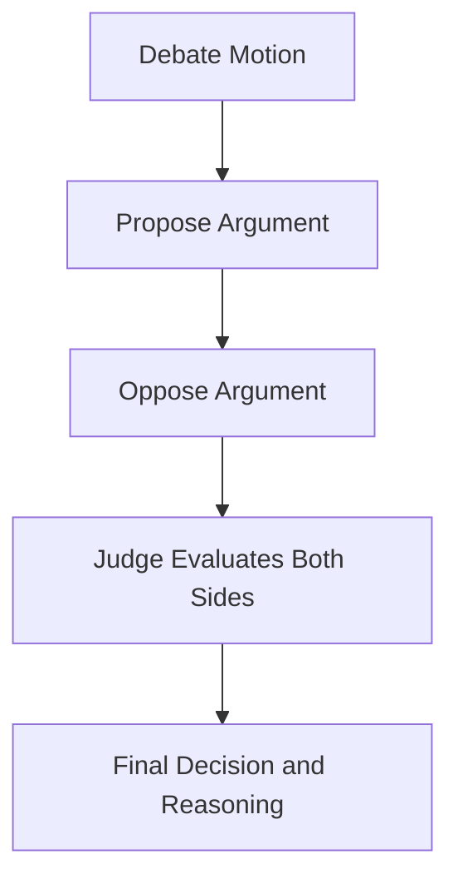

# Debate Crew — Multi-Agent AI Debate

A multi-agent debate application built with **CrewAI**. It takes a motion, generates arguments for and against it, and then asks a separate judge agent to evaluate both sides and decide which argument is more convincing.

The current example debates the motion:

> There needs to be strict laws to regulate LLMs.

## How It Works

The crew executes three tasks sequentially:

1. **Propose:** The debater agent creates an argument supporting the motion.
2. **Oppose:** The debater agent creates an argument opposing the motion.
3. **Decide:** The judge evaluates both arguments, selects the more convincing side, and explains its decision.



## Agents and Models

| Agent | Responsibility | Model |
|---|---|---|
| Debater | Creates arguments for and against the motion | `deepseek-v4-flash` |
| Judge | Evaluates the arguments and chooses the stronger position | `gemini-3.5-flash-lite` |

Both models are configured through the MixRoute API endpoint in `src/debate/crew.py`.

The crew uses CrewAI's sequential process, so each task runs in the order defined in `src/debate/config/tasks.yaml`.

**Note:** The same debater agent is reused for the proposing and opposing tasks. They are separate tasks, not separate debater agents.

## Tech Stack

- **Python:** `>=3.10,<3.14`
- **CrewAI:** `1.14.4`
- **uv:** Python package and environment management
- **MixRoute:** LLM API access
- **YAML:** Agent and task configuration

## Getting Started

### Prerequisites

Install Python 3.10–3.13 and [uv](https://docs.astral.sh/uv/).

### 1. Clone the repository

```bash
git clone <your-repository-url>
cd crewai-debate
```

Replace the repository URL and directory name with your actual GitHub repository details.

### 2. Install dependencies

```bash
uv sync
```

### 3. Configure environment variables

Create a `.env` file in the project root:

```env
MIXROUTE_API_KEY=your_mixroute_api_key
```

Replace the placeholder with your MixRoute API key. Keep this key private and never commit your `.env` file to GitHub.

### 4. Run the debate

```bash
uv run run_crew
```

The application starts from `src/debate/main.py` and prints the final result to the terminal.

## Example Debate Motion

The current motion is defined in `src/debate/main.py`:

```python
inputs = {
    "motion": "There needs to be strict laws to regulate LLMs"
}
```

To debate another topic, replace the value of `motion` with your preferred statement.

For example:

```python
inputs = {
    "motion": "Artificial intelligence will create more jobs than it eliminates"
}
```

Run the application again to generate arguments for and against the new motion.

## Output Files

The crew saves the results of its tasks to Markdown files:

| File | Description |
|---|---|
| `output/propose.md` | Argument supporting the motion |
| `output/oppose.md` | Argument opposing the motion |
| `output/decide.md` | Judge's decision and explanation |

The final crew result is also printed through `result.raw`.


